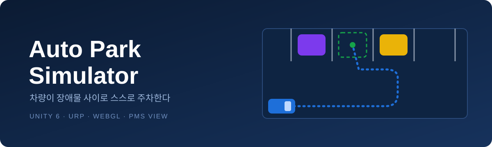

<div align="center">




### 차량이 장애물 사이로 스스로 주차하는 장면을, 키 하나로 바로 돌려 본다.

Unity 6로 만든 **자동 주차(AutoPark) 시뮬레이션 데모**입니다.<br>
웨이포인트 경로를 따라 **회전 · 전진 · 후진**하며 주차하고, WebGL로 빌드해 **브라우저에서 바로 시연**할 수 있습니다.


[**시작하기**](#시작하기) · [**조작법**](#조작법) · [**폴더 지도**](#폴더-지도) · [**WebGL 실행**](#webgl로-빌드하고-실행하기) · [**시나리오 만들기**](#시나리오-커스터마이징) · [**자주 막히는 곳**](#자주-막히는-곳)

</div>

---

## 시작하기

> [!IMPORTANT]
> **Unity 6000.3.1f1 이 필요합니다.** 버전이 다르면 프로젝트를 열 때
> 경고가 뜨고, 패키지가 어긋날 수 있습니다. 같은 버전으로 맞춰 주세요.

```bash
git clone https://github.com/AUTONOMOUS-PCC-Inc/auto-park-simulator.git
cd auto-park-simulator
```

| 준비물 | 어디서 받나 | 확인하는 법 |
|---|---|---|
| **Unity Hub** | [unity.com/download](https://unity.com/download) | 실행이 되면 끝 |
| **Unity 6000.3.1f1** | Unity Hub → Installs | Hub 목록에 버전이 보인다 |
| **WebGL Build Support** | 에디터 설치 시 모듈로 체크 | `Build Profiles` 에 WebGL 이 보인다 |
| **Python 3.x** | WebGL 을 로컬에서 띄울 때만 | `python --version` |

> [!TIP]
> **에디터에서 바로 보려면 Python 은 필요 없습니다.** Python 은 WebGL 빌드를
> 브라우저로 띄울 때만 씁니다.

### Unity 에서 열기

1. **Unity Hub** 실행 → `Add` → 클론한 폴더 선택
2. 에디터 버전이 **6000.3.1f1** 인지 확인
3. 메인 씬 `Assets/Scenes/SampleScene.unity` 열기
4. 상단 ▶ **Play** → `1`~`4` 키로 시나리오 확인

> [!NOTE]
> 처음 열면 Unity 가 `Library/` 를 다시 만들어서 **몇 분** 걸립니다.

---

## 조작법

| 키 | 동작 |
|:--:|------|
| `1` ~ `4` | 주차 시나리오 1~4 실행 |
| `0` | 시작 위치(`EntryPoint`)로 리셋 |
| `V` | 카메라 전환 (팔로우 ↔ 탑뷰) |

> [!NOTE]
> WebGL 화면은 **한 번 클릭해서 포커스를 준 뒤**에 키를 눌러야 반응합니다.

### 이런 걸 보여 줍니다

- 🅿️ **4가지 주차 시나리오** — 키 하나로 서로 다른 주차 상황 실행
- 🧭 **웨이포인트 자동 주행** — 경로를 따라 회전·전진·후진
- 🚧 **장애물 차량 자동 배치** — 시나리오마다 주변 차 위치가 바뀜
- 🎥 **카메라 전환** — 팔로우 뷰와 위에서 내려보는 탑뷰
- 📱 **반응형 카메라** — PC 가로 / 모바일 세로에 맞춰 FOV·높이 자동 조정
- 📈 **경로 시각화** — `LineRenderer` 로 바닥에 주행 경로 표시

> 화면 타이틀은 **PMS View** (Parking Management System) 입니다.

---

## 폴더 지도

"어느 파일을 보면 되지"가 가장 먼저 막히는 지점이라, 먼저 봐 두면 좋습니다.

```
auto-park-simulator/
├── Assets/
│   ├── Scenes/SampleScene.unity     ← 메인 씬
│   ├── Scripts/                     ← 게임 로직 (아래 표)
│   ├── Azerilo/                     ← 차량 3D 모델 (서드파티)
│   └── Materials/ · Images/ · ...   ← 리소스
├── Packages/manifest.json           ← 패키지 의존성 (URP, Input System 등)
├── ProjectSettings/                 ← Unity 프로젝트 설정
└── autopark/
    ├── index.html                   ← WebGL 호스팅 페이지
    ├── server.py                    ← gzip 지원 로컬 서버
    └── Build/                       ← 직접 빌드해서 채우는 곳 (git 제외)
```

기억할 것은 둘입니다. **코드는 `Assets/Scripts/` 에 다섯 파일뿐**이고,
**`autopark/Build/` 는 클론에 따라오지 않으니 직접 빌드해야 합니다.**

### 스크립트 개요

| 파일 | 역할 |
|------|------|
| `AutoParkController.cs` | 핵심 컨트롤러 — 시나리오 실행, 차량 배치, 웨이포인트 주행, 경로 시각화 |
| `AutoParkWaypoint.cs` | 경유점 옵션 — `reverse`(후진 구간), `waitSeconds`(도착 후 대기) |
| `CameraToggle.cs` | `V` 키로 팔로우/탑 뷰 전환 |
| `FollowCam.cs` | 차량을 부드럽게 따라가는 추적 카메라 |
| `FitPerspectiveCameraByAspect.cs` | 화면 비율에 맞춰 카메라 FOV·높이 조정 |

---

## 동작 흐름

```
키 입력 (1~4) ──→ 시나리오 선택 ──→ 장애물 차량 배치 ──→ EntryPoint 로 이동
                                                              │
                                                              ▼
    주차 완료 ←── 마지막 웨이포인트 자세로 정렬 ←── 웨이포인트 순서대로 주행
                                                   (회전 · 전진 · 후진 · 대기)
```

**마지막 웨이포인트의 위치와 회전이 곧 최종 주차 자세**입니다.

---

## WebGL로 빌드하고 실행하기

> [!IMPORTANT]
> 저장소에는 **빌드 결과물이 들어 있지 않습니다.** `autopark/Build/` 가 없으면
> 페이지가 비어 있고 404 만 납니다. 아래 순서로 먼저 빌드하세요.

### 1. 빌드

1. `File > Build Profiles` (또는 `Build Settings`) 열기
2. 플랫폼을 **WebGL** 로 선택 → `Switch Platform`
3. `Build` 클릭 → 출력 폴더를 **`autopark/`** 로 지정

빌드가 끝나면 `autopark/Build/` 에 `autopark.loader.js`, `autopark.wasm.gz` 등이 생깁니다.
`index.html` 이 이 이름(`autopark.*`)을 그대로 불러오므로 **이름을 바꾸지 마세요.**

### 2. 로컬 서버로 실행

```bash
cd autopark
python server.py --port 8080
```

브라우저에서 **http://localhost:8080/** 으로 접속합니다.

> [!TIP]
> Unity WebGL 은 gzip 파일을 올바른 헤더로 받아야 로드됩니다.
> `server.py` 가 `.js.gz` · `.wasm.gz` · `.data.gz` 에 맞는 `Content-Type` 과
> `Content-Encoding: gzip` 을 자동으로 붙여 줍니다. 일반 `http.server` 는 안 됩니다.

---

## 시나리오 커스터마이징

하나의 시나리오는 **세 가지 요소**로 이루어집니다.

| # | 요소 | 어떻게 |
|:-:|------|------|
| 1 | **주행 경로** | `Waypoints1`~`4` 부모 아래에 빈 오브젝트 `WP01`, `WP02` … 를 순서대로 배치 |
| 2 | **후진 · 대기** | 해당 웨이포인트에 `AutoParkWaypoint` 를 붙이고 `reverse` 체크 또는 `waitSeconds` 설정 |
| 3 | **장애물 차량** | `CarPose1`~`4` 아래 pose 오브젝트로 위치 지정 (비워 두면 그 시나리오에선 비활성화) |

> [!CAUTION]
> **웨이포인트 이름은 두 자리 숫자(`WP01`, `WP02`)로 지으세요.** `WP1`, `WP10` 처럼
> 쓰면 정렬 순서가 꼬여 경로가 엉뚱하게 이어집니다.

- 경로 맨 앞에는 `EntryPoint` 가 **자동으로** 추가됩니다
- 마지막으로 `AutoParkController` 인스펙터에서 `Waypoints Root`, `CarSet (s1~s4)`, `EgoRoot`, `EntryPoint` 를 연결합니다

### 주행감 조절

| 파라미터 | 의미 |
|---|---|
| `speed` | 이동 속도 |
| `turnSpeed` | 회전 반응 속도 |
| `arriveDist` | 웨이포인트 도착 판정 거리 |

---

## 자주 막히는 곳

| 증상 | 왜 | 어떻게 |
|---|---|---|
| WebGL 페이지가 비어 있고 404 가 난다 | `autopark/Build/` 가 없다 | Unity 에서 WebGL 로 빌드, 출력 폴더를 `autopark/` 로 |
| 빌드는 했는데 로딩이 실패한다 | gzip 헤더 없이 서빙했다 | `python -m http.server` 말고 **`server.py`** 로 띄운다 |
| 키를 눌러도 반응이 없다 | WebGL 캔버스에 포커스가 없다 | 화면을 **한 번 클릭**한 뒤 누른다 |
| `'python'은(는) 내부 또는 외부 명령...` | Python 이 PATH 에 없다 | Python 설치 후 터미널을 새로 연다 |
| 프로젝트를 열 때 버전 경고가 뜬다 | 에디터 버전이 다르다 | Hub 에서 **6000.3.1f1** 을 설치해 연다 |
| 처음 여는 데 한참 걸린다 | `Library/` 를 새로 만드는 중이다 | 정상입니다. 몇 분 기다린다 |
| 차가 엉뚱한 순서로 움직인다 | 웨이포인트 이름 정렬이 꼬였다 | `WP01`, `WP02` 처럼 **두 자리**로 맞춘다 |
| 시나리오를 눌러도 차가 안 나온다 | 인스펙터 연결이 빠졌다 | `AutoParkController` 의 참조 필드를 다시 연결 |

---

## 라이선스

별도 명시가 없는 한 학습 · 데모 목적으로 자유롭게 사용하세요.
`Assets/Azerilo` 의 차량 모델 등 서드파티 에셋은 각 제공처의 라이선스를 따릅니다.

---

<div align="center">
<sub><strong>Auto Park Simulator</strong> · Unity 6 · URP · WebGL</sub><br>
<sub><a href="https://github.com/AUTONOMOUS-PCC-Inc/auto-park-simulator">github.com/AUTONOMOUS-PCC-Inc/auto-park-simulator</a></sub>
</div>
